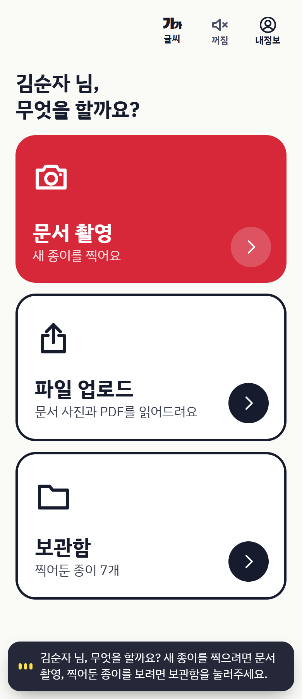
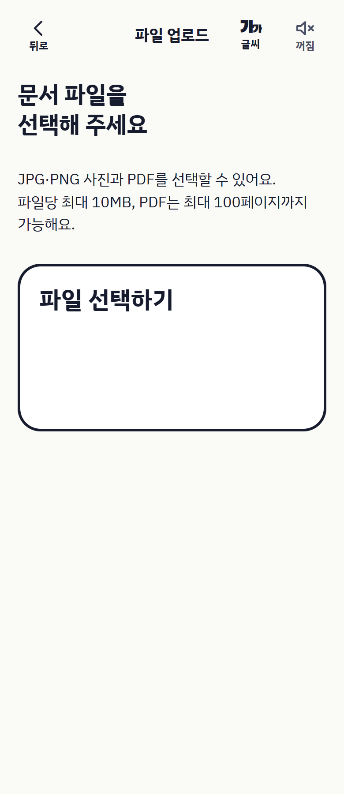
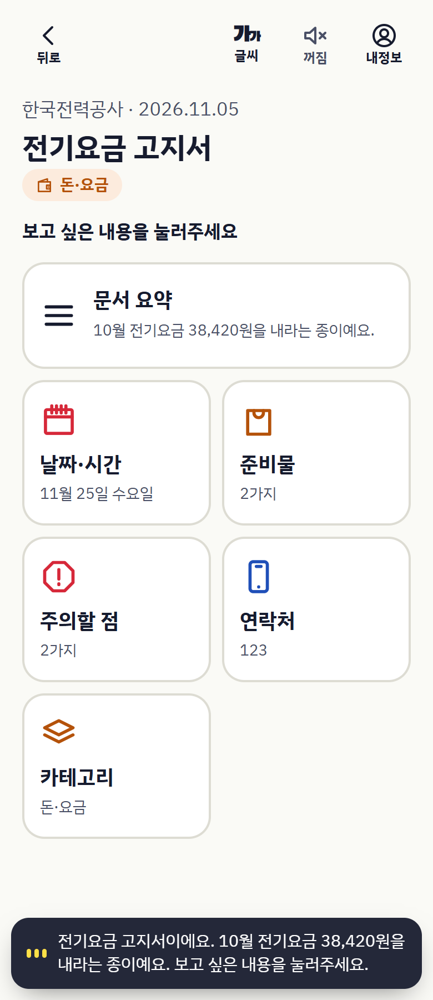
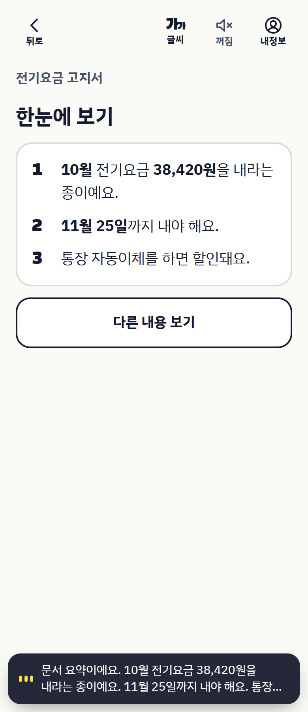
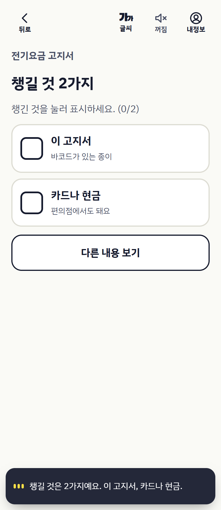
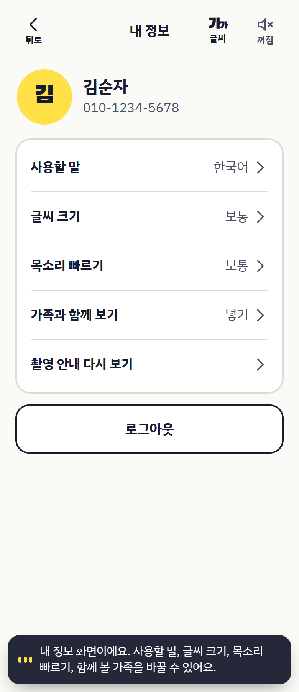
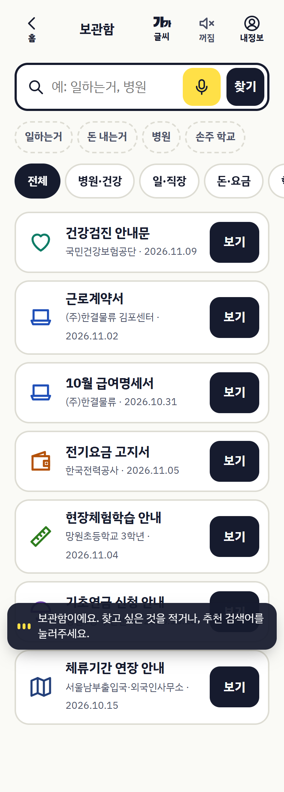
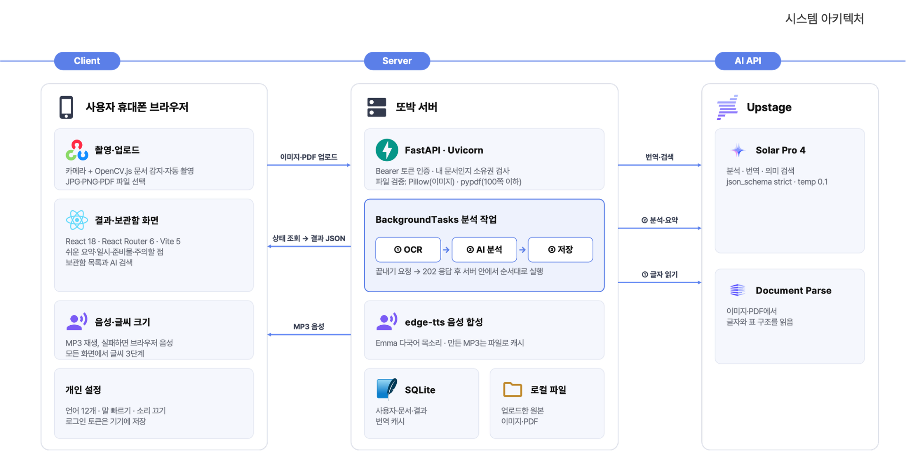
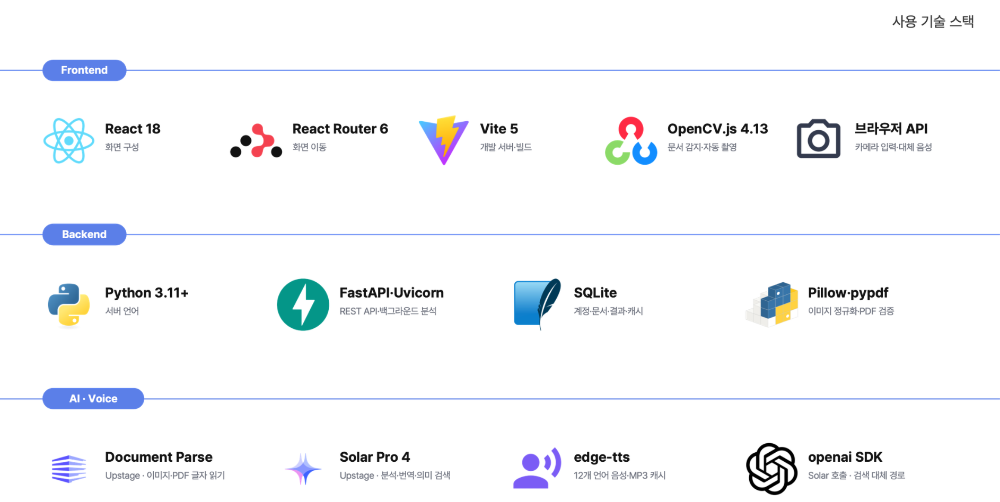

<div align="center">


# 복잡한 안내문을, 쉬운 행동으로.

**종이 문서를 찍으면 AI가 핵심 정보와 해야 할 일을 쉬운 말과 음성으로 안내하는 생활 문서 도우미**

<sub>고지서 · 학교 안내문 · 병원 서류 — 고령자와 한국어가 익숙하지 않은 외국인 주민을 위해 만들었습니다</sub>

<br>

[](https://react.dev)
[](https://vitejs.dev)
[](https://fastapi.tiangolo.com)
[](https://www.sqlite.org)
[](https://www.upstage.ai)

</div>

---

## 목차

- [1. 서비스 소개](#overview)
- [2. 서비스 화면](#screens)
- [3. 주요 기능](#features)
- [4. AI가 문서를 읽는 과정](#ai-pipeline)
- [5. 아키텍처](#architecture)
- [6. 기술 스택](#tech-stack)
- [7. 실행 방법](#getting-started)
- [8. API 문서](#api)

---

<a name="overview"></a>

## 1. 서비스 소개

> **“사진은 찍었는데, 설명은 이해하기 어려워요.”**

또박은 **안내문을 받고도 무엇을 해야 할지 알기 어렵다**는 문제에서 출발했습니다. 작은 글씨로 빼곡하게 적힌 고지서에서 고령자가 납부 기한을 찾거나, 한국어가 익숙하지 않은 외국인 주민이 학교 안내문에서 아이의 준비물을 골라내려면 같은 문장을 여러 번 읽어야 할 때가 있습니다.

그래서 또박은 문서를 찍으면 **언제까지, 어디로, 무엇을 챙겨야 하는지**부터 보여 줍니다. 필요한 항목을 골라 큰 글씨로 읽거나 음성으로 듣고, 나중에 보관함에서 같은 문서를 다시 열 수 있습니다.

<table width="100%">
<thead><tr>
  <th width="200" align="center">누구를 위해</th>
  <th width="600">어떤 어려움을</th>
</tr></thead>
<tbody>
<tr><td align="center"><strong>고령자</strong></td><td>작은 글씨와 행정 용어 속에서 납부 기한·금액·연락처를 찾기 어려움</td></tr>
<tr><td align="center"><strong>외국인 주민</strong></td><td>학교·관공서 안내문의 한국어 문장에서 준비물과 일정을 골라내기 어려움</td></tr>
</tbody>
</table>

<p align="center">
  <strong>문서 촬영 · 업로드</strong>&nbsp;&nbsp;→&nbsp;&nbsp;<strong>AI 분석</strong>&nbsp;&nbsp;→&nbsp;&nbsp;<strong>필요한 정보 확인 · 듣기</strong>&nbsp;&nbsp;→&nbsp;&nbsp;<strong>보관함에서 다시 찾기</strong>
</p>

---

<a name="screens"></a>

## 2. 서비스 화면

### 2.1 문서를 올리고, 필요한 내용을 고르세요

<table width="100%">
<thead><tr><th align="center">홈</th><th align="center">파일 업로드</th><th align="center">분석 결과</th></tr></thead>
<tbody><tr>
  <td align="center"></td>
  <td align="center"></td>
  <td align="center"></td>
</tr></tbody>
</table>

### 2.2 쉬운 설명과 체크리스트로 확인하세요

<table width="100%">
<thead><tr><th align="center">쉬운 요약</th><th align="center">준비물 체크리스트</th><th align="center">내 정보 · 읽기 설정</th></tr></thead>
<tbody><tr>
  <td align="center"></td>
  <td align="center"></td>
  <td align="center"></td>
</tr></tbody>
</table>

<details>
<summary><strong>보관함 화면 펼쳐 보기</strong></summary>
<br>
<p align="center"></p>
</details>

<sub>화면은 [저장소의 시연 문서](backend/seed.py)를 표시해 캡처했습니다. 문서 내용은 화면 소개를 위한 예시 데이터입니다.</sub>

---

<a name="features"></a>

## 3. 주요 기능

### 3.1 문서 읽기

<table width="100%">
<thead><tr>
  <th width="200">기능</th>
  <th width="600">내용</th>
</tr></thead>
<tbody>
<tr><td><strong>문서 촬영 · 업로드</strong></td><td>브라우저 카메라 촬영, OpenCV.js 기반 문서 테두리 감지와 자동 촬영, JPG·PNG 및 PDF 업로드</td></tr>
<tr><td><strong>AI 문서 분석</strong></td><td>Upstage Document Parse로 글자와 표를 읽고, Solar Pro 4로 쉬운 요약과 핵심 정보를 추출</td></tr>
<tr><td><strong>정보별 상세 안내</strong></td><td>요약 · 날짜·시간 · 장소 · 준비물 · 주의사항 · 연락처를 항목별 화면으로 제공</td></tr>
<tr><td><strong>원문 보기</strong></td><td>찍거나 올린 원본을 그대로 다시 확인. PDF는 앱 안에서 바로 열람</td></tr>
<tr><td><strong>읽기 지원</strong></td><td>화면 음성 안내와 다시 듣기, 글씨 크기·음성 속도 설정</td></tr>
<tr><td><strong>번역</strong></td><td>분석 결과 번역과 번역 캐시. 번역에 실패하면 한국어 원문을 표시</td></tr>
</tbody>
</table>

### 3.2 문서 다음에 할 일

<table width="100%">
<thead><tr>
  <th width="200">기능</th>
  <th width="600">내용</th>
</tr></thead>
<tbody>
<tr><td><strong>준비물 체크</strong></td><td>준비물을 하나씩 체크하고, 다시 열어도 체크한 상태를 기억</td></tr>
<tr><td><strong>길 찾기</strong></td><td>문서에 적힌 장소를 카카오맵 검색으로 바로 연결</td></tr>
<tr><td><strong>알림 받기</strong></td><td>달력에 날짜를 표시해 보여 주는 화면 <sub>(시연용 · 실제 알림은 보내지 않음)</sub></td></tr>
</tbody>
</table>

### 3.3 보관과 계정

<table width="100%">
<thead><tr>
  <th width="200">기능</th>
  <th width="600">내용</th>
</tr></thead>
<tbody>
<tr><td><strong>문서 보관함</strong></td><td>분석이 끝난 문서를 카테고리별로 모아 보고, 필요 없는 문서는 삭제</td></tr>
<tr><td><strong>말로 찾기</strong></td><td>“돈 내는 거”처럼 일상적인 표현으로 검색. 음성 인식으로 말해서 찾기 지원</td></tr>
<tr><td><strong>계정 · 설정</strong></td><td>전화번호 인증 기반 회원가입·로그인, 내 정보 수정, 가족 연락처 등록·삭제</td></tr>
</tbody>
</table>

<details>
<summary><strong>업로드 제한과 지원 언어</strong></summary>
<br>

- 업로드는 파일당 **10MB 이하**, PDF는 **100페이지 이하**로 검증합니다.
- 언어 선택과 번역 API는 **12개 언어 코드**를 지원합니다. 보관함·결과·상세 화면은 **한국어·영어·일본어·중국어**를 지원하며, 나머지 언어를 고르면 이 화면과 문서 내용은 영어로 표시합니다.

</details>

---

<a name="ai-pipeline"></a>

## 4. AI가 문서를 읽는 과정

<table width="100%">
<thead><tr>
  <th width="60" align="center">단계</th>
  <th width="180">작업</th>
  <th width="560">내용</th>
</tr></thead>
<tbody>
<tr><td align="center"><strong>1</strong></td><td><strong>글자와 표 읽기</strong></td><td>서버가 검증한 이미지나 PDF를 Upstage Document Parse에 보냅니다. 표 안에서 날짜와 항목의 관계가 유지되도록 응답에서 마크다운을 우선 읽습니다.</td></tr>
<tr><td align="center"><strong>2</strong></td><td><strong>핵심 정보 추출</strong></td><td>Solar Pro 4에 원문과 정해진 JSON 스키마를 함께 전달합니다. 모델은 쉬운 한국어로 최대 세 문장의 요약을 쓰고 날짜·장소·준비물·주의사항·연락처를 각 필드에 담습니다.<br>서버는 <strong>날짜와 금액을 원문과 대조</strong>해 다시 확인할 부분을 표시합니다.</td></tr>
<tr><td align="center"><strong>3</strong></td><td><strong>결과 번역</strong></td><td>다른 언어로 결과를 열면 저장된 분석 결과에서 번역할 텍스트만 골라 Solar에 보냅니다. 서버는 <strong>번역 전후의 숫자를 검사</strong>하고 번역본을 SQLite에 저장해 같은 요청에 재사용합니다.</td></tr>
<tr><td align="center"><strong>4</strong></td><td><strong>보관함 검색</strong></td><td>Solar가 사용자의 완료 문서에서 제목·분류·요약을 읽고 관련 문서와 이유를 고릅니다. 서버는 이 결과를 키워드·동의어 검색과 합칩니다. 모델 호출에 실패해도 키워드 검색은 동작합니다.</td></tr>
</tbody>
</table>

---

<a name="architecture"></a>

## 5. 아키텍처

<a href="docs/architecture.png"></a>

브라우저가 문서를 올리고 분석을 요청하면 서버는 `202 Accepted`를 바로 돌려줍니다. 이후 FastAPI 백그라운드 작업이 **문서 인식 → AI 분석 → 결과 저장**을 차례로 수행하고, 브라우저는 상태 API로 완료 여부를 확인한 뒤 저장된 결과를 불러옵니다.

---

<a name="tech-stack"></a>

## 6. 기술 스택

<a href="docs/tech-stack.png"></a>

### 6.1 Frontend


### 6.2 Backend


### 6.3 AI · Voice


<sub>검색 API는 Upstage 키가 없을 때 OpenAI 키를 쓰는 경로도 갖고 있습니다. <strong>OCR·문서 분석·번역에는 Upstage 키가 필요</strong>하며, 검색의 키워드 대체 경로가 문서 분석을 대신하지는 않습니다.</sub>

---

<a name="getting-started"></a>

## 7. 실행 방법

### 7.1 준비

<table width="100%">
<tbody>
<tr><td width="200"><strong>Python</strong></td><td width="600">3.11 이상</td></tr>
<tr><td><strong>Node.js</strong></td><td>18 이상 및 npm</td></tr>
<tr><td><strong>API 키</strong></td><td>문서 인식·분석·번역을 위한 <code>UPSTAGE_API_KEY</code></td></tr>
<tr><td><strong>네트워크</strong></td><td>외부 AI 및 음성 서비스에 연결할 수 있는 환경</td></tr>
</tbody>
</table>

```bash
git clone https://github.com/whdpcks/easytone-ttobak.git
cd easytone-ttobak
```

### 7.2 백엔드

<details open>
<summary><strong>macOS / Linux</strong></summary>

```bash
cd backend
python3 -m venv .venv
source .venv/bin/activate
pip install -r requirements.txt
cp .env.example .env
```

</details>

<details>
<summary><strong>Windows PowerShell</strong></summary>

```powershell
cd backend
py -3.11 -m venv .venv
.\.venv\Scripts\Activate.ps1
pip install -r requirements.txt
Copy-Item .env.example .env
```

</details>

`backend/.env`에 `UPSTAGE_API_KEY`를 입력한 다음, 같은 터미널에서 실행합니다. API 키가 없으면 문서 분석은 실패 상태와 오류 안내를 반환합니다.

```bash
uvicorn main:app --reload --port 8000
```

<details>
<summary><strong>환경 변수</strong></summary>
<br>

| 환경 변수 | 기본 예시 | 설명 |
| --- | --- | --- |
| `UPSTAGE_API_KEY` | 직접 입력 | OCR·분석·번역 API 키 |
| `TTOBAK_DB_PATH` | `data/ttobak.db` | 공통 SQLite 경로 |
| `TTOBAK_SEED_DEMO` | `1` | 시연 사용자·가족 데이터 생성 |
| `TTOBAK_SMS_MODE` | `demo` | 앱 안에서 인증번호 표시 |
| `TTOBAK_CORS_ORIGINS` | 빈 값 | 개발 시 전체 허용. 배포 시 허용할 프론트 주소 지정 |

경로는 `backend`에서 실행할 때를 기준으로 합니다. 업로드 파일은 기본 `backend/data/uploads`, 음성 캐시는 DB 경로 아래 `tts_cache`에 저장됩니다. 실제 키가 든 `.env`는 커밋하지 않습니다.

</details>

### 7.3 프론트엔드

저장소 루트에서 **새 터미널**을 열어 실행합니다.

```bash
cd frontend
npm ci
npm run dev
```

<table width="100%">
<tbody>
<tr><td width="200"><strong>앱</strong></td><td width="600"><a href="http://localhost:5173">http://localhost:5173</a></td></tr>
<tr><td><strong>서버 상태</strong></td><td><a href="http://localhost:8000/health">http://localhost:8000/health</a></td></tr>
<tr><td><strong>프록시</strong></td><td>Vite가 <code>/api</code> 요청을 <code>http://localhost:8000</code>으로 전달하며 <code>/api</code> 접두사를 제거합니다.</td></tr>
<tr><td><strong>카메라</strong></td><td>권한 허용이 필요합니다. 로컬 PC에서는 <code>localhost</code>로 접속하고, 휴대전화 등 다른 기기에서는 HTTPS 환경을 준비해야 합니다.</td></tr>
</tbody>
</table>

### 7.4 시연과 검증

`TTOBAK_SEED_DEMO=1`이면 시연 계정이 생성됩니다. 로그인 화면에서 **`010-1234-5678`** 을 입력하고 인증번호를 요청하세요. 데모 문자 알림을 누르면 인증번호가 자동 입력됩니다.

```bash
# backend — 테스트
python -m unittest discover -s tests -v
python -m unittest discover -s b_capture/tests -v

# frontend — 빌드
npm run build
```

<sub>테스트의 가짜 OCR·AI 응답과 실제 외부 API 동작은 별개입니다. 실제 문서 분석은 유효한 Upstage 키로 확인해야 합니다.</sub>

---

<a name="api"></a>

## 8. API 문서

서버 실행 후 FastAPI가 제공하는 문서에서 요청·응답 스키마를 확인하고 API를 호출할 수 있습니다.

<p align="center">
  <a href="http://localhost:8000/docs"><strong>Swagger UI</strong></a>&nbsp;&nbsp;·&nbsp;&nbsp;<a href="http://localhost:8000/redoc"><strong>ReDoc</strong></a>&nbsp;&nbsp;·&nbsp;&nbsp;<a href="http://localhost:8000/openapi.json"><strong>OpenAPI JSON</strong></a>
</p>

아래는 백엔드 경로입니다. 프론트엔드 개발 서버를 통할 때는 앞에 `/api`를 붙입니다. 인증 API와 `/health`, `/tts`를 제외한 API는 `Authorization: Bearer <token>`이 필요하며, 문서별 API는 소유권도 확인합니다.

<details open>
<summary><strong>인증 · 사용자</strong></summary>
<br>

| 메서드 | 경로 | 용도 |
| --- | --- | --- |
| GET | `/health` | 서버 상태 |
| POST | `/auth/send-code` | 인증번호 요청 |
| POST | `/auth/signup` · `/auth/login` | 회원가입·로그인, 토큰 발급 |
| POST | `/auth/logout` | 로그아웃 |
| GET / PATCH | `/me` | 내 정보 조회·수정 |
| GET / POST | `/me/family` | 가족 연락처 조회·등록 |
| DELETE | `/me/family/{member_id}` | 가족 연락처 삭제 |

</details>

<details open>
<summary><strong>문서 · 검색 · 음성</strong></summary>
<br>

| 메서드 | 경로 | 용도 |
| --- | --- | --- |
| POST | `/documents` | 문서 생성 |
| POST | `/documents/{id}/pages` | 이미지·PDF 업로드 (`multipart/form-data`의 `file`) |
| GET | `/documents/{id}/pages` | 원문 보기 — 찍거나 올린 원본 목록 |
| GET | `/documents/{id}/pages/{page_id}/file` | 원본 파일 (사진 JPG 또는 올린 PDF) |
| POST | `/documents/{id}/finish` | 업로드 종료·분석 시작 |
| GET | `/documents/{id}/status` | 분석 상태와 진행 단계 |
| GET | `/documents/{id}` | 완료된 분석 결과 |
| DELETE | `/documents/{id}` | 문서 삭제 |
| GET | `/documents/{id}/translation?lang=en` | 번역 결과 조회·생성 |
| GET | `/documents?category=학교·아이&lang=ko` | 내 완료 문서 목록·분류 필터 |
| GET | `/search?q=병원&lang=ko` | 내 문서 검색 |
| GET | `/tts?text=안녕하세요&lang=ko&rate=1.0` | MP3 음성 합성 (최대 300자) |

</details>

### 8.1 문서 분석 흐름

```
POST /documents                 →  id 발급
POST /documents/{id}/pages      →  파일 추가 (여러 장 가능)
POST /documents/{id}/finish     →  202 · status: "queued"
GET  /documents/{id}/status     →  done: true 가 될 때까지 조회
GET  /documents/{id}            →  결과 읽기 (실패 시 error 안내)
```

- `status`는 `capturing` · `processing` · `completed` · `failed`, 진행 단계 `step`은 `ocr` · `ai` · `saving` 또는 `null`입니다.
- 분석이 끝나기 전에 결과를 요청하면 `409`를 반환합니다.
- 결과는 `summary`, `datetime`, `place`, `items`, `cautions`, `contact` 등을 포함합니다. `null`은 정보 없음, `datetime.check: true`는 날짜를 원문과 다시 확인해야 한다는 표시입니다.

<table width="100%">
<tbody>
<tr><td width="200"><strong>JSON 스키마</strong></td><td width="600"><a href="contracts/document-result.schema.json">문서 결과</a> · <a href="contracts/document-status.schema.json">문서 상태</a></td></tr>
<tr><td><strong>응답 예시</strong></td><td><a href="contracts/examples">contracts/examples</a> <sub>— 실제 AI 응답이 아닌 개발용 목업</sub></td></tr>
</tbody>
</table>

---

<div align="center">

<br>

**작은 글씨 너머, 누구나 이해할 수 있는 세상.**

<br>

</div>
