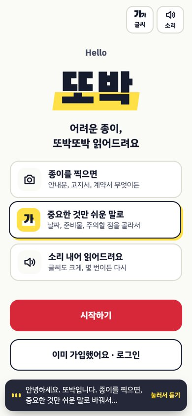
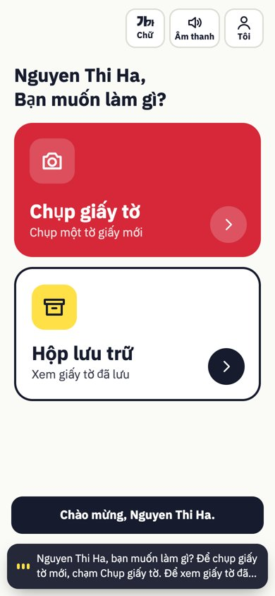
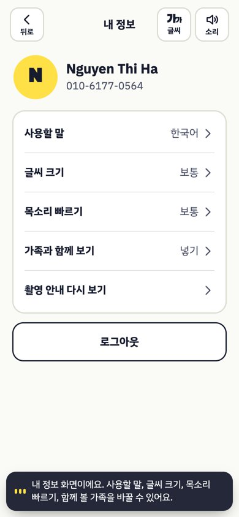
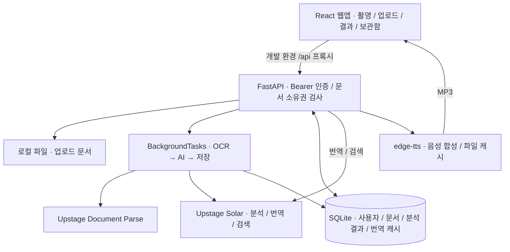

<div align="center">

# 또박 · TTObak

### 복잡한 안내문을, 쉬운 행동으로.

종이 문서를 촬영하면 AI가 핵심 정보와 해야 할 일을<br>
**쉬운 말과 음성으로 안내하는 생활 문서 도우미**

React · FastAPI · Upstage · SQLite

[서비스 소개](#01-서비스-소개) · [서비스 화면](#02-서비스-화면) · [주요 기능](#03-주요-기능) · [아키텍처](#04-아키텍처)<br>
[기술 스택](#05-기술-스택) · [실행 방법](#06-실행-방법) · [API 문서](#07-api-문서)

</div>

---

## 01. 서비스 소개

**“사진은 찍었는데, 설명은 이해하기 어려워요.”**

학교 안내문, 공공기관 공지, 요금 고지서처럼 일상에서 만나는 문서에는 어려운 용어와 놓치기 쉬운 정보가 담겨 있습니다.

또박은 고령자와 한국어에 익숙하지 않은 사용자가 문서를 이해할 수 있도록, 원문에서 확인한 **요약·날짜·장소·준비물·주의사항·연락처**를 나누어 보여줍니다. 큰 글씨와 음성 안내로 읽기를 돕고, 분석한 문서는 보관함에서 다시 찾을 수 있습니다.

**문서 촬영 또는 업로드 → AI 분석 → 필요한 정보 확인 → 보관함에서 다시 찾기**

## 02. 서비스 화면

저장소에 포함된 실제 앱 캡처입니다. 시작 화면, 베트남어 홈 화면, 한국어 내 정보 화면을 소개합니다.

<table>
  <tr>
    <th align="center">시작하기</th>
    <th align="center">문서 촬영으로 진입</th>
    <th align="center">나에게 맞는 설정</th>
  </tr>
  <tr>
    <td align="center"></td>
    <td align="center"></td>
    <td align="center"></td>
  </tr>
</table>

[전체 화면 캡처 보기](docs/screenshots/a-common-base)

## 03. 주요 기능

| 기능 | 현재 구현 |
| --- | --- |
| 문서 촬영·업로드 | 브라우저 카메라 촬영, OpenCV 기반 문서 감지·자동 촬영, JPG/PNG 및 PDF 업로드 |
| AI 문서 분석 | Upstage Document Parse로 글자를 읽고 Solar로 쉬운 요약과 핵심 정보 추출 |
| 정보별 상세 안내 | 요약, 날짜·시간, 장소, 준비물, 주의사항, 연락처, 카테고리별 화면 제공 |
| 읽기 지원 | 화면 음성 안내·다시 듣기, 글씨 크기와 음성 속도 설정 |
| 문서 보관함·검색 | 분석 완료 문서의 카테고리 필터, AI 의미 검색과 키워드·동의어 검색 결합 |
| 번역 | 문서 번역 API와 번역 캐시, 번역 실패 시 한국어 원문 표시 |
| 계정·설정 | 전화번호 인증 기반 회원가입·로그인, 내 정보 수정, 가족 연락처 등록·삭제 |

- 업로드는 파일당 **10MB 이하**, PDF는 **100페이지 이하**로 검증합니다.
- 언어 선택 및 번역 API는 12개 언어 코드를 지원합니다. 현재 보관함·결과·상세 화면은 **한국어·영어·일본어·중국어**를 지원하며, 나머지 언어를 선택하면 이 화면과 문서 내용은 영어로 표시합니다.
- 분석기는 원문에 없는 정보를 만들지 않도록 요청하고, 일부 날짜·금액을 원문과 대조합니다. 확인이 필요한 날짜에는 경고를 표시하며, 정보가 없는 상세 항목은 숨깁니다. AI 결과의 정확성을 보장하는 기능은 아니므로 중요한 내용은 원문과 함께 확인해야 합니다.

<details>
<summary><strong>시연 기능과 구현 범위</strong></summary>

- 문자 인증은 기본적으로 데모 모드입니다. 실제 SMS 대신 앱의 문자 알림에 인증번호를 보여줍니다. 실제 문자 발송 업체는 연결되어 있지 않습니다.
- 날짜 상세의 **알림 받기**는 동작이 연결되지 않았습니다. **길 찾기**와 **카테고리 변경**은 시연 안내만 표시합니다.
- 준비물 체크는 현재 화면의 상태로 관리하며 서버에 저장하지 않습니다.
- 가족 연락처 관리는 구현되어 있지만 문서 공유·가족 알림 기능은 제공하지 않습니다.
- 개인정보 자동 마스킹과 원문 근거 줄 번호 표시는 구현되어 있지 않습니다.
- 서버 음성 합성에 실패하면 브라우저 내장 음성을 시도합니다. 음성 제공 여부는 네트워크와 브라우저 환경에 따라 달라집니다.

</details>

## 04. 아키텍처



촬영 완료 요청이 FastAPI의 백그라운드 작업으로 분석을 시작합니다. 프론트엔드는 상태 API를 조회하고 완료된 결과를 표시합니다. 별도의 작업 큐 서버는 사용하지 않습니다.

```text
easytone-ttobak/
├── frontend/           # React·Vite 웹앱
│   └── src/
│       ├── capture/    # 촬영·문서 감지·업로드
│       ├── pages/      # 홈·보관함·결과·상세
│       ├── common/     # 인증·설정·음성·공통 UI
│       └── api/        # 서버 요청
├── backend/
│   ├── main.py         # FastAPI 공통 진입점
│   ├── common/         # 인증·DB·문자·음성
│   ├── b_capture/      # 파일 검증·저장·촬영 API
│   ├── c_analysis/     # OCR·분석·번역·결과 저장
│   ├── routers/        # 보관함·검색 API
│   └── tests/          # 백엔드 테스트
├── contracts/          # 결과·상태 JSON 스키마와 예시
├── docs/screenshots/   # 앱 화면 캡처
└── b-capture-demo/      # 별도 촬영 데모
```

## 05. 기술 스택

| 영역 | 기술 | 용도 |
| --- | --- | --- |
| 프론트엔드 | React 18, React Router 6, Vite 5 | 화면·라우팅·개발 서버 |
| 문서 촬영 | 브라우저 카메라 API, OpenCV.js 4.13 | 카메라 입력·문서 감지 |
| 백엔드 | Python 3.11+, FastAPI, Uvicorn | REST API·백그라운드 분석 |
| 문서 인식 | Upstage Document Parse | 이미지·PDF의 텍스트 추출 |
| AI | Upstage Solar (`solar-pro4`) | 구조화 분석·번역·의미 검색 |
| 저장소 | SQLite, 로컬 파일 시스템 | 계정·문서·결과·캐시 저장 |
| 파일 검증 | Pillow, pypdf | 이미지 정규화·PDF 검증 |
| 음성 | edge-tts, 브라우저 음성 합성 | MP3 안내·대체 음성 |

검색 API는 Upstage 키가 없을 때 OpenAI 키를 사용하는 경로도 갖고 있습니다. **OCR·문서 분석·번역에는 Upstage 키가 필요**하며, 검색의 키워드 대체 경로가 문서 분석을 대신하지는 않습니다.

## 06. 실행 방법

### 준비

- Python **3.11 이상**
- Node.js **18 이상** 및 npm
- 문서 인식·분석·번역을 위한 `UPSTAGE_API_KEY`
- 외부 AI 및 음성 서비스에 연결할 수 있는 네트워크

```bash
git clone https://github.com/whdpcks/easytone-ttobak.git
cd easytone-ttobak
```

### 백엔드

**macOS / Linux**

```bash
cd backend
python3 -m venv .venv
source .venv/bin/activate
pip install -r requirements.txt
cp .env.example .env
```

**Windows PowerShell**

```powershell
cd backend
py -3.11 -m venv .venv
.\.venv\Scripts\Activate.ps1
pip install -r requirements.txt
Copy-Item .env.example .env
```

생성한 `backend/.env`의 `UPSTAGE_API_KEY`를 입력한 다음, 같은 터미널에서 실행합니다. API 키가 없으면 문서 분석은 실패 상태와 오류 안내를 반환합니다.

```bash
uvicorn main:app --reload --port 8000
```

| 환경 변수 | 기본 예시 | 설명 |
| --- | --- | --- |
| `UPSTAGE_API_KEY` | 직접 입력 | OCR·분석·번역 API 키 |
| `TTOBAK_DB_PATH` | `data/ttobak.db` | 공통 SQLite 경로 |
| `TTOBAK_SEED_DEMO` | `1` | 시연 사용자·가족 데이터 생성 |
| `TTOBAK_SMS_MODE` | `demo` | 앱 안에서 인증번호 표시 |
| `TTOBAK_CORS_ORIGINS` | 빈 값 | 개발 시 전체 허용. 배포 시 허용할 프론트 주소 지정 |

위 경로는 `backend`에서 실행할 때를 기준으로 합니다. 업로드 파일은 기본 `backend/data/uploads`, 음성 캐시는 DB 경로 아래 `tts_cache`에 저장됩니다. 실제 키가 든 `.env`는 커밋하지 않습니다.

### 프론트엔드

저장소 루트에서 **새 터미널**을 열어 실행합니다.

```bash
cd frontend
npm ci
npm run dev
```

- 앱: [http://localhost:5173](http://localhost:5173)
- 서버 상태: [http://localhost:8000/health](http://localhost:8000/health)
- Vite가 `/api` 요청을 `http://localhost:8000`으로 전달하며 `/api` 접두사를 제거합니다.
- 카메라는 권한 허용이 필요합니다. 로컬 PC에서는 `localhost`로 접속하고, 휴대전화 등 다른 기기에서는 HTTPS 환경을 준비해야 합니다.

### 시연과 검증

`TTOBAK_SEED_DEMO=1`이면 기본 시연 계정이 생성됩니다. 로그인 화면에서 `010-1234-5678`을 입력하고 인증번호를 요청하세요. 데모 문자 알림을 누르면 인증번호가 자동 입력됩니다.

백엔드 테스트는 `backend`에서 실행합니다.

```bash
python -m unittest discover -s tests -v
python -m unittest discover -s b_capture/tests -v
```

프론트엔드 빌드는 `frontend`에서 실행합니다.

```bash
npm run build
```

테스트의 가짜 OCR·AI 응답과 실제 외부 API 동작은 별개입니다. 실제 문서 분석은 유효한 Upstage 키로 확인해야 합니다.

## 07. API 문서

서버 실행 후 FastAPI가 제공하는 문서에서 요청·응답 스키마를 확인하고 API를 호출할 수 있습니다.

**[Swagger UI](http://localhost:8000/docs) · [ReDoc](http://localhost:8000/redoc) · [OpenAPI JSON](http://localhost:8000/openapi.json)**

아래는 백엔드 경로입니다. 프론트엔드 개발 서버를 통할 때는 앞에 `/api`를 붙입니다. 인증 API와 `/health`, `/tts`를 제외한 아래 API는 `Authorization: Bearer <token>`이 필요합니다. 문서별 API는 소유권도 확인합니다.

| 메서드 | 경로 | 용도 |
| --- | --- | --- |
| GET | `/health` | 서버 상태 |
| POST | `/auth/send-code` | 인증번호 요청 |
| POST | `/auth/signup` · `/auth/login` | 회원가입·로그인, 토큰 발급 |
| POST | `/auth/logout` | 로그아웃 |
| GET / PATCH | `/me` | 내 정보 조회·수정 |
| GET / POST | `/me/family` | 가족 연락처 조회·등록 |
| DELETE | `/me/family/{member_id}` | 가족 연락처 삭제 |
| POST | `/documents` | 문서 생성 |
| POST | `/documents/{id}/pages` | 이미지·PDF 업로드 (`multipart/form-data`의 `file`) |
| POST | `/documents/{id}/finish` | 업로드 종료·분석 시작 |
| GET | `/documents/{id}/status` | 분석 상태와 진행 단계 |
| GET | `/documents/{id}` | 완료된 분석 결과 |
| GET | `/documents/{id}/translation?lang=en` | 번역 결과 조회·생성 |
| GET | `/documents?category=학교·아이&lang=ko` | 내 완료 문서 목록·분류 필터 |
| GET | `/search?q=병원&lang=ko` | 내 문서 검색 |
| GET | `/tts?text=안녕하세요&lang=ko&rate=1.0` | MP3 음성 합성 (최대 300자) |

### 문서 분석 흐름

1. `POST /documents` → 생성된 `id`를 받습니다.
2. `POST /documents/{id}/pages` → 파일을 추가합니다.
3. `POST /documents/{id}/finish` → `202`와 `status: "queued"`를 받습니다.
4. `GET /documents/{id}/status` → `done`이 `true`가 될 때까지 조회합니다.
5. 완료 시 `GET /documents/{id}`로 결과를 읽고, 실패 시 `error`를 안내합니다.

상태 조회의 `status`는 `capturing`, `processing`, `completed`, `failed`이며 진행 단계 `step`은 `ocr`, `ai`, `saving` 또는 `null`입니다. 분석이 끝나기 전에 결과를 요청하면 `409`를 반환합니다.

결과는 `summary`, `datetime`, `place`, `items`, `cautions`, `contact` 등을 포함합니다. `null`은 정보 없음을 뜻하며, `datetime.check: true`는 날짜를 원문과 다시 확인해야 한다는 표시입니다.

- [문서 결과 JSON 스키마](contracts/document-result.schema.json)
- [문서 상태 JSON 스키마](contracts/document-status.schema.json)
- [응답 예시](contracts/examples) — 실제 AI 응답이 아닌 개발용 목업

---

<div align="center">

<strong>작은 글씨 너머, 누구나 이해할 수 있는 세상.</strong>

</div>
